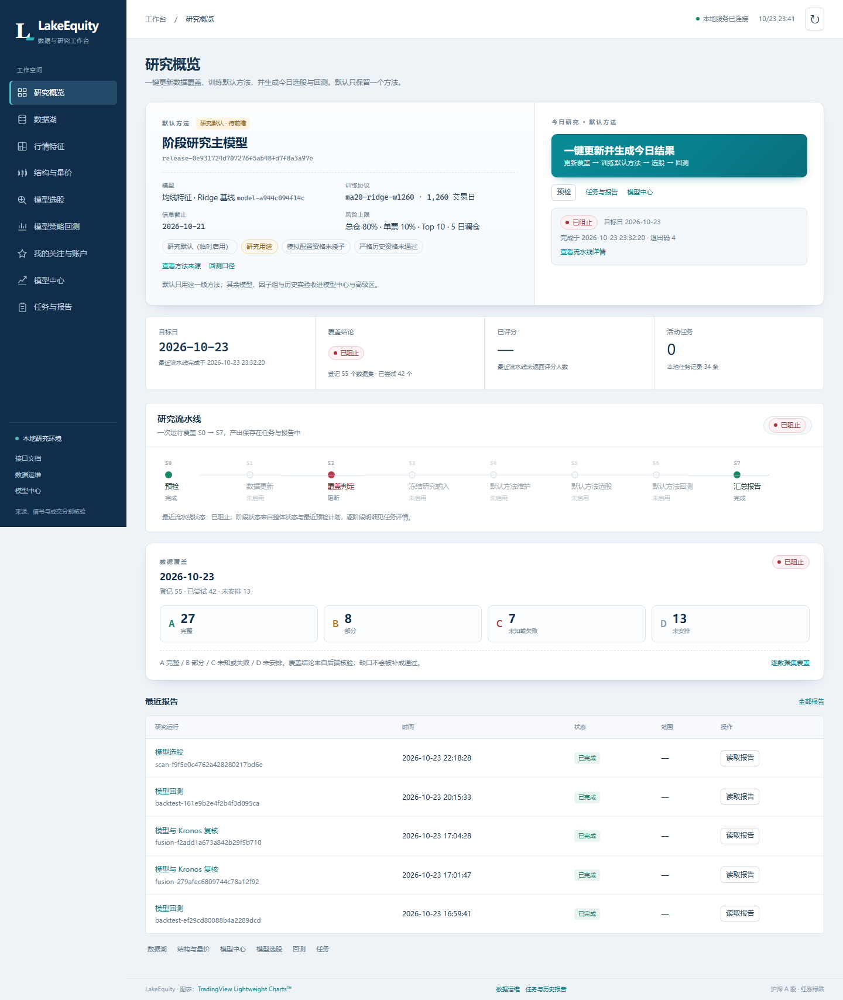
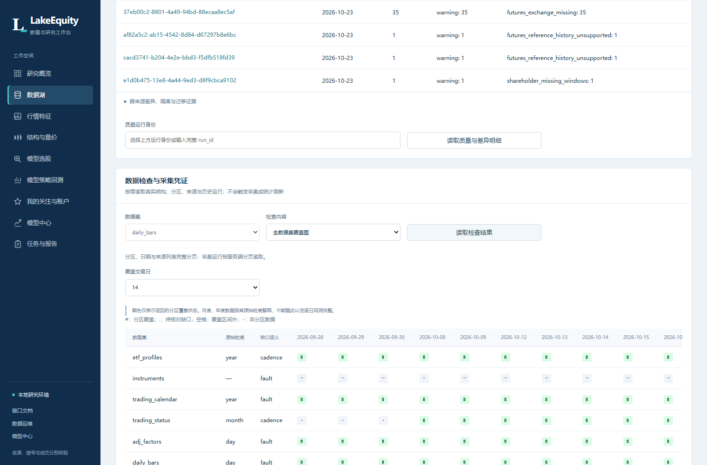
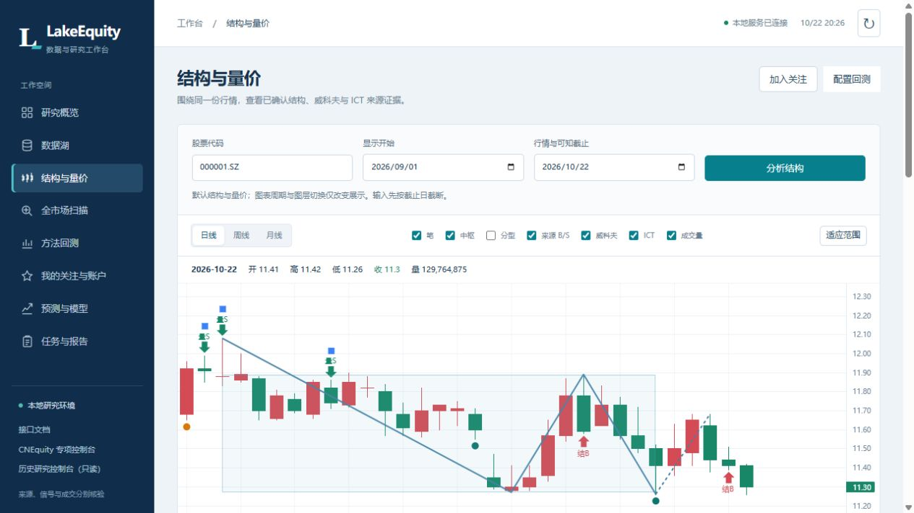
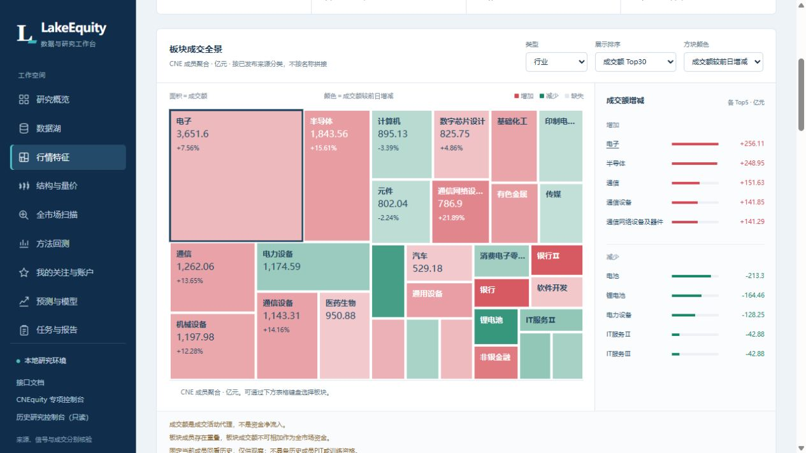

# LakeEquity

本地 A 股数据湖与量化研究 Dashboard。将 CNEquity 的版本化行情、融资融券等因子接入统一训练，使用 Ridge、LightGBM 与均线多因子 MLP，训练后的冻结模型可用于全市场选股和组合回测。

LakeEquity 自有代码采用 [MIT](LICENSE)。内置 CNEquity、CZSC、Kronos 和前端图表资源保留各自许可证，详见 [第三方声明](THIRD_PARTY_NOTICES.md)。

[下载发行版](https://github.com/zhaozhenxiong/Lake_equity/releases) · [版本更新](docs/CHANGELOG.md) · [研究流程](docs/PIPELINE.md) · [安装与打包说明](docs/RELEASE.md)

## 界面预览

| 研究概览 · 单一默认方法与一键流程 | 数据湖 · 覆盖检查与来源证据 |
| --- | --- |
| [](docs/assets/overview.png) | [](docs/assets/data-coverage.png) |
| **结构与量价 · K 线、笔与中枢** | **行情特征 · 板块成交全景** |
| [](docs/assets/structure-analysis.jpg) | [](docs/assets/market-features.jpg) |

以上使用开发期已有截图，点击可查看原图。界面中的日期、覆盖、模型身份与阻断状态是拍摄时的快照；首次安装从空运行目录开始，实际状态以本机检查为准。图片来源、原始尺寸和 SHA-256 见 [素材说明](docs/assets/README.md)。

## 安装与启动

当前安装路径面向 **Windows x64、Python 3.12**。从本仓库克隆，或下载 Releases 中的源码 ZIP 并解压，在项目目录执行：

```powershell
py -3.12 install.py --device cpu
.\lake.bat serve
```

打开 <http://127.0.0.1:8130>。安装程序创建独立 `.venv`、本机 `configs/cnequity.toml` 和运行目录 `var/`，从依赖源联网安装软件，并核验随包原生引擎及公开源码 SHA-256。

NVIDIA 环境可显式选择 `--device cuda`，安装 CUDA 13.0 版 PyTorch；实际执行设备以任务报告为准。仓库包含上游 macOS ARM64 原生 wheel，但本次发行未执行 macOS/Linux 安装验收，不能据此声称跨平台可用。

**首次安装不附带行情、训练权重、Kronos 模型资产、个人账户或历史研究记录。** 请在数据湖中配置并采集你有权使用的数据，检查发布版本、交易日历和覆盖范围后再训练；缺少数据时页面保持空状态。Kronos 需另行准备合法模型资产。首次启动和能力目录就绪不代表数据已经完整。

## 配置

LakeEquity 自身设置使用环境变量，不读取额外的应用 TOML 示例文件：

| 变量 | 用途与默认值 |
| --- | --- |
| `LAKE_EQUITY_HOME` | 项目根目录；默认按安装位置解析 |
| `LAKE_EQUITY_PORT` | 服务端口；默认 `8130` |
| `LAKE_EQUITY_RAW_DB` | 研究输入 SQLite；默认 `var/research_inputs/current/khquant_raw.db` |
| `LAKE_EQUITY_DEVICE` | 可选计算设备覆盖；默认由研究引擎自动选择 |
| `LAKE_EQUITY_API_TOKEN` | API 访问令牌；绑定非回环地址时必须设置 |

`configs/cnequity.toml` 是安装器生成、由本机数据配置使用的文件，已被 `.gitignore` 排除；不要把其中的绝对路径或凭据复制进公开配置。

## 一键流程与单一默认方法

“研究概览”页只有一个主按钮：**一键更新并生成今日结果**。它按固定顺序执行全量数据更新、覆盖判定、研究输入物化、默认方法维护、默认方法选股与回测，完成后给出流水线报告。任一必需数据不完整时会在覆盖判定阶段明确阻断，不产生“最终排名”。

```powershell
.\.venv\Scripts\python.exe -B run.py pipeline --dry-run   # 只读预检，不写数据
.\.venv\Scripts\python.exe -B run.py pipeline             # 真正执行一键流程
```

- **默认方法**：日常流程解析当前 active 策略发布（`GET /api/v1/strategy/active`），默认页面无需选择模型、回测模式或历史序列；研究对比、训练与历史版本在“模型中心 → 高级”及归档中查看。
- **训练语义**：日常一键复用 active 发布，自动检查重拟合是否到期；`--refit now` 显式执行单协议重拟合，只生成候选发布，不自动切换。协议更换按预注册的研究复核规则处理。
- **模型归档**：保留仍被引用的模型，将其余历史版本归档为只读，不删除产物与历史报告；实际数量由本机归档预览给出。
- 覆盖结论、退出码、归档与当前边界见 [一键流水线与默认方法](docs/PIPELINE.md)。

## 研究流程

1. 在“数据湖”检查数据集、真实日期覆盖、质量和来源，显式执行所需采集任务。新数据必须发布为固定代际，快照数据不能冒充历史已知信息。
2. 在“研究概览”先运行只读预检，再按需执行一键流程。系统沿用单一默认策略发布，覆盖不合格时明确阻断。
3. 需要研究对比时，进入“模型中心 → 高级”配置股票池、训练窗口、因子组和设备，先检查输入再提交训练。查看各滚动窗口的 IC、Rank IC、误差、费用后模拟收益和同样本等权基准；处理器仅拟合训练段，训练、验证与测试标签按时间隔离。量价 38 项已含 20 项均线特征，加 5 项融资融券后共 43 项，实际有效列以报告为准。
4. 在“模型选股”按默认方法对固定沪深 A 股人口分批推理并统一排名；缺失、失败、未处理和动态池排除均保留在结果中。扫描不会重新训练；指定冻结版本和股票池在高级区调整。
5. 在“模型策略回测”使用默认方法与真实区间；需要比较固定模型、历史滚动或已保存序列时，在高级区明确模式与时序边界。Broker/Ledger 共同处理共享现金、下一可执行开盘、整手、T+1、费用、拒单和期末库存。

MLP 使用 `d→64→32→1`，与传统模型共用有序因子和训练期预处理。最终重拟合会生成独立模型身份，不覆盖原样本外结果，也不自动设置 champion 或开启纸上账户。

Dashboard 同时提供结构与量价、板块特征、关注与账户、任务与报告。当前公开后端统一为 `/api/v1`；旧控制台及 `/native`、`/api/lake`、`/api/khquant` 已退役。冻结第三方源码继续作为内部计算库使用。

## 可选 Qlib 环境

默认本地后端可运行三类算法。Qlib 后端使用独立环境，避免改变主环境数值依赖；`requirements-qlib.lock` 是 Windows Python 3.12 的固定依赖清单：

```powershell
py -3.12 -m venv var/runtimes/qlib
.\var\runtimes\qlib\Scripts\python.exe -m pip install -r requirements-qlib.lock
.\.venv\Scripts\python.exe scripts/verify_learning_runtime.py --backend qlib
```

验证通过后才将 Qlib 后端显示为可用。其数据组件和传统模型接口接入本地固定代际；MLP 使用主环境 Torch，并如实记录实际引擎。量价特征参考 Alpha158 设计，尚未声称逐项精确复现 Alpha158。

## 核验与文档

```powershell
.\lake.bat verify-sources
.\lake.bat doctor
.\.venv\Scripts\python.exe -m pip install -r requirements-dev.lock
.\.venv\Scripts\python.exe -m pytest tests -q
```

`doctor` 会如实报告数据、日历和模型资产缺项；空安装显示 `partial` 是预期情况。公开源码包的 `release-manifest.json` 列出实际分发文件、大小和 SHA-256，校验失败返回非零退出码。

2026-10-27 维护回归为 **920 项通过、1 项按既有本地证据门槛跳过**；公开包包含 2,190 个文件，生产锁 95 项，开发锁额外 3 项。精简实测、历史验收和未覆盖项见 [版本记录](docs/CHANGELOG.md) 与 [发行说明](docs/RELEASE.md)。

- [多因子学习、CLI 与模型身份](docs/LEARNING.md)
- [版本更新与发布范围](docs/CHANGELOG.md)
- [一键流水线与默认方法](docs/PIPELINE.md)
- [Sharpe 研究与验证](docs/SHARPE_OPTIMIZATION_PLAN.md)
- [模拟执行规则与局限](docs/EXECUTION_RULES.md)
- [板块行情特征](docs/MARKET_FEATURES.md)
- [统一接口与旧入口迁移](docs/LEGACY_RETIREMENT.md)
- [发行内容、复核与打包](docs/RELEASE.md)

研究数据、当前成分股、复权、公司行为和因子真实可得时间仍需逐项核验。训练完成或历史收益为正不能证明未来盈利、严格历史 PIT 或实盘可用性。

## 目录

```text
src/lake_equity/           数据、学习、模型注册、扫描、回测与 API
frontend/                 当前 Dashboard 与本地图表资源
packages/khquant_research/ 冻结研究引擎、CZSC/Kronos 来源及原生 wheel
vendor/cnequity/           冻结 CNEquity 源码与原许可证
third_party/              补充的第三方许可正文及来源索引
tests/                    隔离的合成数据测试
docs/assets/              已有界面截图与来源校验说明
docs/provenance/          公开来源摘要与依赖身份
var/                      本机行情、模型、账户和运行状态，不公开分发
```
